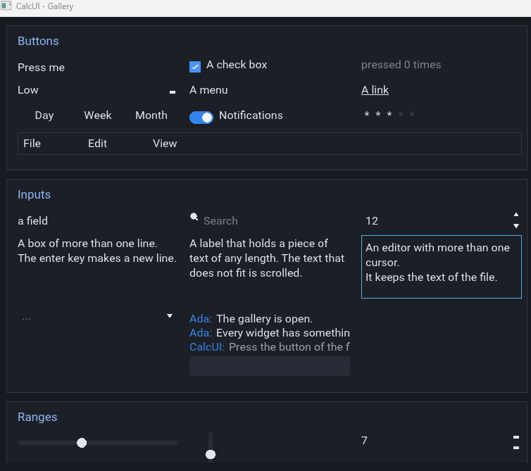

# CalcUI

[](https://github.com/armscream/CalcUI/actions/workflows/test.yml)
[](LICENSE)
[](https://odin-lang.org/)
[](https://github.com/sponsors/armscream)

A renderer-agnostic, retained-mode GUI toolkit written in Odin.

CalcUI keeps a persistent widget tree, updates layout incrementally and builds draw lists for any backend. The examples use SDL3, but the core does not depend on it: integrating another renderer and window system only requires a backend that implements the interface.

Interfaces can be built in code, loaded from scene files, or both. Scenes can be saved and loaded at runtime, in the spirit of Godot's scene system.

> CalcUI is still a work in progress. APIs may change between releases.

## Screenshots

<table>
  <tr>
    <td align="center"></td>
    <td align="center"></td>
  </tr>
  <tr>
    <td align="center"></td>
    <td align="center"></td>
  </tr>
</table>

## Features

- Retained-mode widget tree with stable widget IDs.
- Dirty-driven incremental layout: only affected branches are re-measured.
- Event-driven frames: an idle app sleeps instead of redrawing.
- Declarative scene files that can be loaded, saved and edited at runtime.
- Renderer-agnostic core with SDL3 renderer, SDL3 GPU and headless backends.
- Rounded shapes, per-side borders, shadows and backdrop glass.
- Docking, floating and detachable panels.
- Text with font families, glyph fallback and DPI-aware rasterization.
- Custom widget classes, themes, signals and multiple windows.
- Headless testing, plus a benchmark suite with regression budgets.

## Quick start

```odin
import GUI "calcui/src/GUI"

g := GUI.Init_GUI(width, height, backend)
defer GUI.Shutdown_GUI(g)

family := GUI.Font_Family_Add(g, "Roboto", FONT_DATA)

GUI.Make_Label(g, g.root, GUI.Label_Opts{
    Base_Opts = GUI.Base_Opts{name = "title"},
    text = "Hello, CalcUI",
})

GUI.Make_Button(g, g.root, GUI.Button_Opts{
    Base_Opts = GUI.Base_Opts{name = "ok"},
    text = "OK",
    on_pressed = on_ok,
})
```

See [`docs/Usage.md`](docs/Usage.md) for the application loop, frame scheduling and the rest of the API.

## Scenes

A scene is text: one `[node ...]` header per widget, followed by `key = value` properties.

```text
[node name="Root" type="Panel"]
    [node name="Title" type="Label" parent="Root"]
        anchors = {0, 0, 1, 0}
        offsets = {20, 20, -20, 56}
        text = "A scene"
```

Load one at runtime with `GUI.Scene_Load(g, text)` or `GUI.Scene_Load_Report`, which also returns diagnostics. Scenes can be saved back to text, and custom classes can register constructors so they work in scene files too.

See [`docs/scene-format.md`](docs/scene-format.md) for the format, properties and loading API.

## Documentation

| Document | Description |
|---|---|
| [`docs/Usage.md`](docs/Usage.md) | Getting started, the application loop and frame scheduling. |
| [`docs/widgets.md`](docs/widgets.md) | Every widget, its options and its functions. |
| [`docs/extending.md`](docs/extending.md) | Custom widget classes, hooks, signals and styling. |
| [`docs/scene-format.md`](docs/scene-format.md) | Scene format, loading, saving and diagnostics. |
| [`docs/node-graph.md`](docs/node-graph.md) | Node graph model, editing, serialization and the blueprint runtime. |
| [`docs/accessibility.md`](docs/accessibility.md) | Accessibility metadata and platform bridges. |
| [`docs/architecture.md`](docs/architecture.md) | Packages, layout, rendering and the frame lifecycle. |
| [`docs/benchmarks.md`](docs/benchmarks.md) | What the benchmarks measure and the reference results. |

## Examples

The `examples` directory contains standalone applications.

| Example | Description |
|---|---|
| `00_hello` | Window, label, button and text field. |
| `01_gallery` | Widget gallery, toolbar, docking and text showcase. |
| `02_docking` | Docking, panel movement and drag-and-drop. |
| `03_text` | Text sizing, colours, alignment and wrapping. |
| `04_overlays` | Detached panels and multiple windows. |
| `05_theming` | Seven themes: dark, light, ocean, liquid glass, neumorphism, Material 3 and Fluent. |
| `06_scene` | Loads a complete UI from a scene string. |
| `07_custom_widget` | A custom widget with its own hooks and style. |
| `08_custom_backend` | CalcUI on a custom renderer. |
| `09_node_graph` | Node graph editor with typed ports, reroutes, inspector, undo, save/load and the headless blueprint runtime. |

## Building

CalcUI needs the [Odin compiler](https://odin-lang.org/).

Prepare the repository:

```sh
./scripts/setup.sh
```

Build all examples with `examples\build.bat` on Windows or `examples/build.sh` on Linux and macOS. To build or run one example:

```sh
odin build examples/01_gallery -out:gallery.exe
odin run examples/01_gallery
```

`App` uses the SDL3 GPU backend and falls back to the SDL3 renderer when the GPU is unavailable. Pass `--renderer` to force the renderer, or `--gpu` to require the GPU:

```sh
odin run examples/01_gallery -- --renderer
```

### Tests

Tests use a headless backend, so GUI logic runs without a window. The CI script checks the packages, runs the tests, builds the examples and generates a test screenshot:

```sh
./scripts/ci.sh
```

GitHub Actions runs the same checks on Windows, Linux and macOS. The test suite also runs the benchmarks; each prints one line and checks a budget, so a slowdown fails the build. See [`docs/benchmarks.md`](docs/benchmarks.md) for details.

### Shaders

Compiled shaders are included, so a shader compiler is not needed to build CalcUI. To rebuild them, run `src/Backend/build_shaders.bat` on Windows or `src/Backend/build_shaders.sh` on Linux and macOS. This requires `glslc` from the Vulkan SDK.

## Project structure

| Directory | Contents |
|---|---|
| `src/GUI` | Public facade (`api.odin`) and the `Core`, `Widgets` and `Animation` packages: widget tree, layout, rendering, text, atlas and themes. |
| `src/NodeGraph` | Renderer-independent node graph model, geometry, styles, port policies, reroutes and serialization. |
| `src/Backend` | SDL3 renderer and SDL3 GPU backends. |
| `src/Window` | Window management, events, popups, cursor and clipboard. |
| `examples` | Example applications. |
| `assets` | Fonts, images and other example assets. |
| `tools` | Development tools, shaders and frame capture utilities. |
| `docs` | Usage, widgets, scenes, node graph, accessibility, architecture and benchmarks. |

## License

CalcUI is licensed under [`LGPL-3.0`](LICENSE). Third-party components keep their own licenses: SDL3 and Runa are zlib, and the ported Skald code is BSD-2-Clause.

See the [NOTICE](NOTICE) file for third-party attributions.
