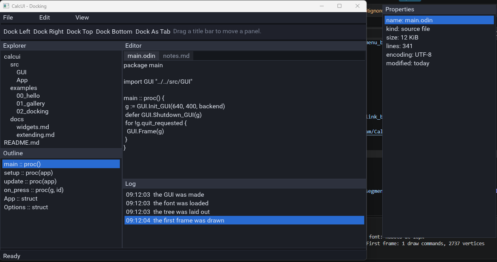
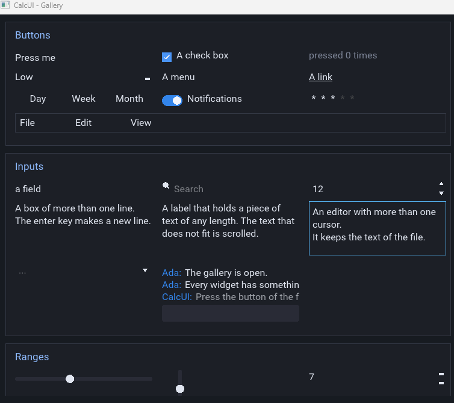
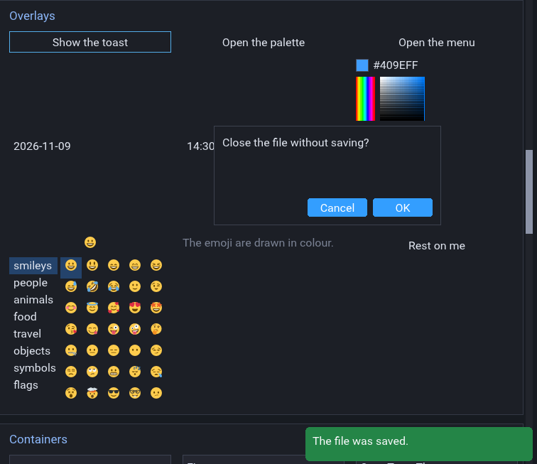
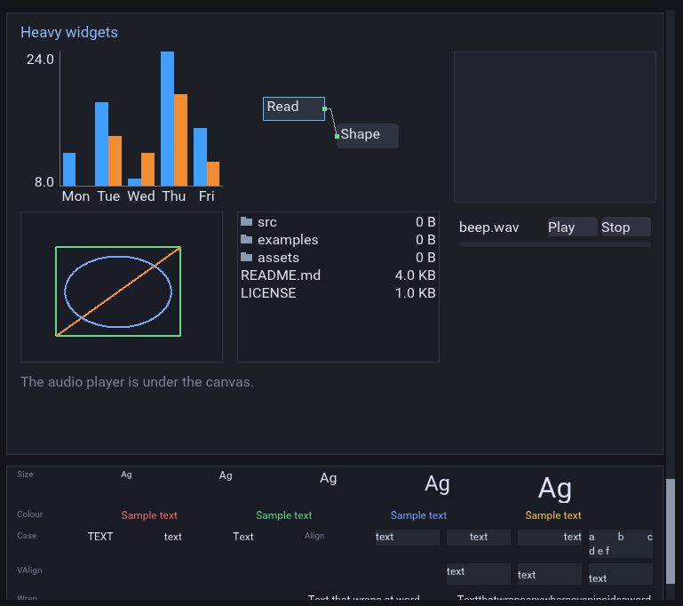

# CalcUI

[](https://github.com/armscream/CalcUI/actions/workflows/test.yml)
[](LICENSE)
[](https://odin-lang.org/)
[](https://github.com/sponsors/armscream)

A renderer-agnostic, retained-mode GUI framework written in Odin.

## **WIP**

CalcUI is a retained-mode GUI toolkit written in "Odin" (https://odin-lang.org/). It provides a persistent widget tree, an incremental layout engine, declarative UI and an extensible rendering architecture.

The GUI core is renderer-agnostic. The included examples use SDL3, but CalcUI can be integrated with other rendering systems by implementing the necessary rendering backend and window/input integration.

Interfaces can be built programmatically or described in scene files, allowing complete UI trees to be serialized, saved and loaded at runtime, similar to Godot's scene-based UI workflow.

## Screenshots

<<<<<<< HEAD
<table>
  <tr>
    <td align="center"></td>
    <td align="center"></td>
  </tr>
  <tr>
    <td align="center"></td>
    <td align="center"></td>
  </tr>
</table>   
=======
<p align="left">
  
</p><p align="right">
  
</p><p align="left">
  
</p><p align="right">
  
</p>Features
>>>>>>> b62a4b88cb49ecf7ea9db35107bd5b5419b13115

- Retained-mode architecture – Persistent widget tree with independent widget identities and state.
- Incremental layout engine – Dirty-driven measurement and arrangement. Only affected layout branches are recalculated.
- Declarative UI – Define interfaces through serialized scene files instead of constructing every widget in code.
- Scene serialization – Save and load widget trees, including their hierarchy and configuration.
- Renderer-agnostic core – Integrate with different rendering backends.
- Batched rendering – Shared texture atlas for text, images and primitives.
- Docking system – Dockspaces, movable panels, floating and detachable panels, split layouts and drag-and-drop.
- Text rendering – Font families, glyph fallback and DPI-aware rasterization.
- Custom widgets – Register custom drawing, measurement, input and lifecycle callbacks.
- Theming – Widget styles, default themes and style variations.
- Multiple windows – Window management, overlays, popups and detached panels.
- Headless testing – Test GUI logic without opening a window.

## Layout Engine

CalcUI uses a fully incremental, dirty-driven layout engine. Rather than recalculating the entire widget tree every frame, changes invalidate the relevant layout state and propagate through affected dependencies.

Measurement and arrangement are cached independently, allowing unchanged portions of the interface to retain their existing layout results.

The layout engine supports several complementary approaches to positioning and sizing.

Sizing and positioning

- Fixed, minimum and maximum dimensions.
- Proportional stretch ratios.
- Size flags for controlling how widgets use available space.
- Anchors and offsets for positioning relative to parent bounds.
- Margins and padding.
- Centering and aspect-ratio constraints.

Container layouts

- HBox – Horizontal child arrangement.
- VBox – Vertical child arrangement.
- Grid – Row and column-based arrangement.
- Flow – Automatic arrangement of content.
- Margin – Spacing around child content.
- ScrollBox – Scrollable content areas.

Complex layouts

- Nested container layouts.
- Split layouts and resizable panels.
- Tabbed containers.
- Scrollable content.
- Dockspaces with floating and detachable panels.

These can be combined to build everything from simple application interfaces to complex editor layouts.

## Widgets

CalcUI includes a broad collection of built-in widgets and interface components.

| Category | Widgets |
|---|---|
| Basic | Buttons, check boxes, toggle switches, ranges, ratings, number inputs |
| Containers | Margin, VBox, HBox, ScrollBox, Accordion |
| Text & Input | Text boxes, rich text editor, search fields, chat input |
| Selection | Combo boxes, color picker, date picker, time picker, emoji picker |
| Menus & Overlays | Command palette, context menus, tooltips, popups, toast notifications |
| Data | Data tables, virtual lists, charts |
| Visualization | Canvas, node graphs, vector drawing |
| File & Content | File viewer |
| Layout | Dockspaces, floating and detachable panels |


# Quick Start

```odin
import GUI "calcui/src/GUI"

g := GUI.Init_GUI(width, height, backend)
defer GUI.Shutdown_GUI(g)

family := GUI.Font_Family_Add(g, "Roboto", FONT_DATA)

GUI.Make_Label(g, g.root, GUI.Label_Opts{
    Base_Opts = GUI.Base_Opts{name = "title"},
    text = "Hello, CalcUI",
})

GUI.Make_Button(g, g.root, GUI.Button_Opts{
    Base_Opts = GUI.Base_Opts{name = "ok"},
    text = "OK",
    on_pressed = on_ok,
})
```

## Declarative UI & Scenes

Interfaces can be constructed programmatically or defined in scene files.

Scene files describe widget hierarchies and their configuration. They can be loaded at runtime, allowing layouts to be saved, reused and edited independently of application logic.

This provides a workflow similar to Godot's scene system: build a UI hierarchy, serialize it, and load it when needed.

Custom widget classes can also register constructors for use in scene files.

See "docs/scene-format.md" (docs/scene-format.md) for the scene format and loading API.

Rendering & Backends

CalcUI separates its GUI core from the underlying rendering and window systems.

The core handles:

- Widget management and layout.
- Input routing and interaction.
- Draw-list construction.
- Text measurement and glyph management.
- Clipping and texture atlas management.

The included backends use SDL3:

- SDL3 Renderer – Standard SDL rendering backend.
- SDL3 GPU – GPU backend supporting Vulkan, D3D12 and Metal.

SDL3 is used by the examples and included integrations, but it is not a requirement of the GUI architecture. Other rendering systems can be integrated by implementing the necessary backend operations and wiring up window events, input, textures and presentation.

## Display Scaling

CalcUI uses logical units for widget geometry, padding, borders, font sizes and image dimensions.

The renderer converts these values into physical pixels using "GUI.scale". Pointer positions and window dimensions are also expressed in logical units.

```odin
g := GUI.Init_GUI(logical_width, logical_height, backend)
GUI.GUI_Set_Scale(g, pixel_density)
```

Call "GUI_Set_Scale" when a window moves between displays with different pixel densities. Glyphs are rasterized again at the new physical size to maintain sharp text.

## Fonts

Font families support fallback chains. When a family does not contain a requested glyph, CalcUI searches its fallback families.

```odin
family := GUI.Font_Family_Add(g, "Roboto", FONT_DATA)
GUI.Font_Family_Set_Fallback(g, family, symbol_family)
```

"GUI.Font_Has_Glyph" checks whether a family or its fallbacks contain a particular codepoint.

## Example Widget - Text Boxes

CalcUI uses a single "TextBox" widget for both single-line and multiline input.

Supported features include:

- Caret positioning and text selection.
- Mouse selection and double-click selection.
- Cut, copy and paste.
- Undo and redo.
- Character filtering and length limits.
- Single-line submission callbacks.
- Multiline wrapping, scrolling and indentation.

Input rules are configured per instance.

```odin
GUI.Make_Text_Box(g, g.root, GUI.Text_Box_Opts{
    Base_Opts = GUI.Base_Opts{name = "amount"},
    rules = GUI.Text_Rules{
        max_length = 6,
        allowed = "0123456789",
    },
})

Use the "Multiline" flag for multiline input:

GUI.Make_Text_Box(g, g.root, GUI.Text_Box_Opts{
    Base_Opts = GUI.Base_Opts{name = "notes"},
    flags = GUI.Text_Box_Flags{.Multiline},
    text = "A multiline text box.",
})
```

See "docs/widgets.md" (docs/widgets.md) for widget behaviour and available options.

## Custom Widgets

Custom widgets are registered as classes. Each class defines callbacks for drawing, measurement and input, with optional lifecycle and layout hooks.

```odin
class := GUI.Widget_Register_Class(g, GUI.Widget_Class_Desc{
    name = "Gauge",
    kind = GUI.Widget_Kind{
        draw = gauge_draw,
        measure = gauge_measure,
        click = gauge_click,
    },
})

id := GUI.Make_Custom_Widget(
    g,
    parent,
    class,
    GUI.Base_Opts{name = "gauge"},
)
```

Custom classes can also define signals, default styles and scene-file constructors.

See "docs/extending.md" (docs/extending.md).

# Examples

The "examples" directory contains standalone applications demonstrating CalcUI's features.

| Example | Description |
|---|---|
| `00_hello` | Basic window, label, button and text field. |
| `01_gallery` | Widget gallery, toolbar, docking and text showcase. |
| `02_docking` | Docking, panel movement and drag-and-drop. |
| `03_text` | Text sizing, colours, alignment and wrapping. |
| `04_overlays` | Detached panels and multiple windows. |
| `05_theming` | Themes and widget styles. |
| `06_data` | Checkboxes, sliders, progress bars, lists and trees. |
| `07_widgets` | Inputs, pickers, chat, tables and command palette. |
| `08_heavy` | Charts, node graphs, canvas and editor widgets. |
| `09_scene` | Scene loading and default themes. |


# Building

CalcUI requires the "Odin compiler" (https://odin-lang.org/).

Prepare the repository:

./scripts/setup.sh

Build the examples:

**Windows:** examples\build.bat

**Linux and macOS:** examples/build.sh


Or build an individual example:

odin build examples/01_gallery -out:gallery.exe
odin run examples/01_gallery

The SDL3 renderer is used by default. Pass "--gpu" to use the SDL3 GPU backend:

odin run examples/01_gallery -- --gpu


**Tests**

Tests use a headless backend, allowing GUI logic to be tested without opening a window.

Run the complete CI checks locally:

./scripts/ci.sh

This checks the GUI, window and backend packages, runs GUI tests, builds the examples and generates a test screenshot.

GitHub Actions runs these checks on Windows, Linux and macOS.

## Project Structure

| Directory | Description |
|---|---|
| `src/GUI` | Widget tree, layout, rendering, text, atlas and themes. |
| `src/Backend` | SDL3 renderer and SDL3 GPU backends. |
| `src/Window` | Window management, events, popups, cursor and clipboard. |
| `examples` | Example applications. |
| `assets` | Fonts, images and other example assets. |
| `tools` | Development tools, shaders and frame capture utilities. |
| `docs` | Usage, widget, extension and scene documentation. |

## Documentation

| Document | Description |
|---|---|
| [`docs/Usage.md`](docs/Usage.md) | Getting started and API overview. |
| [`docs/widgets.md`](docs/widgets.md) | Widget behaviour and available options. |
| [`docs/extending.md`](docs/extending.md) | Creating custom widgets. |
| [`docs/scene-format.md`](docs/scene-format.md) | Scene format and loading. |   


## Shaders

Compiled shaders are included in the repository, so a shader compiler is not needed to build CalcUI.

To rebuild them:

**Windows**
src\Backend\build_shaders.bat

**Linux and macOS**
src/Backend/build_shaders.sh

Shader compilation requires "glslc", available through the Vulkan SDK.

# License

CalcUI is licensed under "LGPL-3.0" (LICENSE).

Third-party components retain their respective licenses:

- SDL3 and Runa: zlib.
- Ported Skald code: BSD-2-Clause.

See [](https://github.com/armscream/CalcUI/blob/main/NOTICE) for third-party attributions.